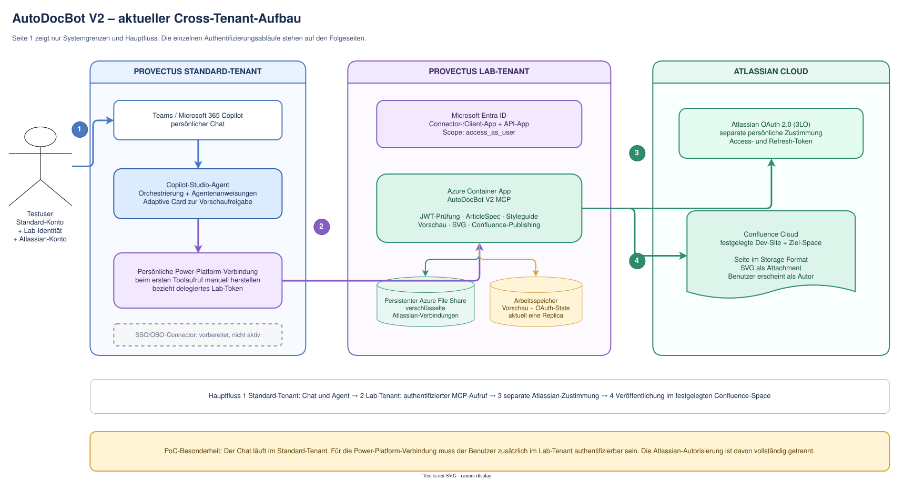
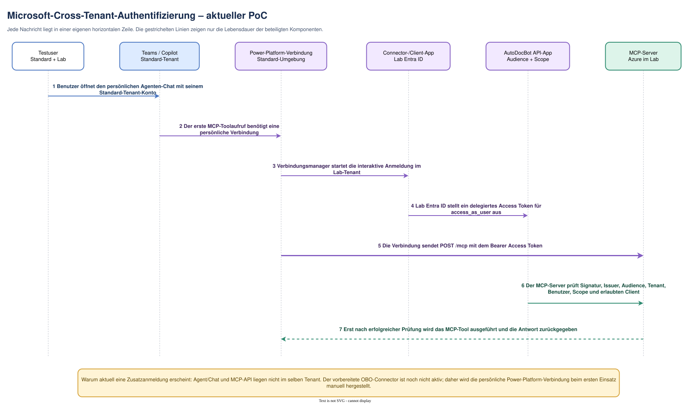
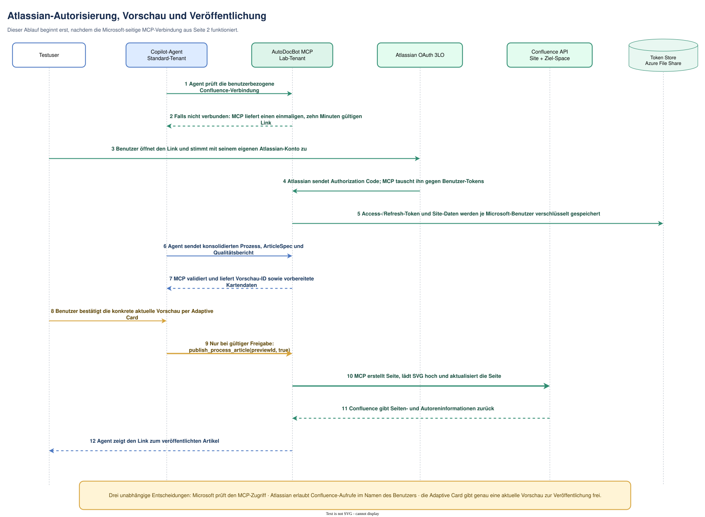
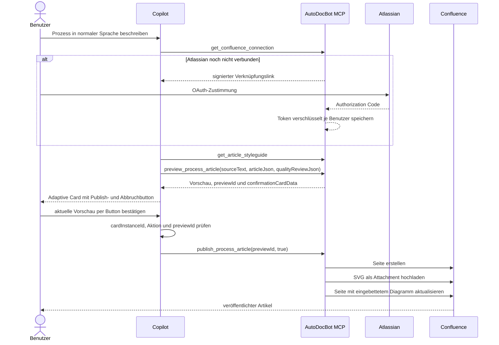

# AutoDocBot V2

AutoDocBot V2 ist ein End-to-End-verifizierter Proof of Concept für einen Copilot-Agenten, der frei formulierte Prozessbeschreibungen in konsistente Confluence-Prozessartikel umwandelt. Der Agent strukturiert den Inhalt, wendet einen verbindlichen und zugleich anpassbaren Styleguide an, erzeugt ein SVG-Prozessdiagramm und veröffentlicht den bestätigten Artikel über einen MCP-Server im Namen des angemeldeten Atlassian-Benutzers.

> Dokumentationsstand: 25. August 2026, Version `0.1.6`. Lokaler Betrieb, Atlassian OAuth 2.0 (3LO), MCP Streamable HTTP, Microsoft-Entra-Authentifizierung, Copilot Studio, semantische Vorprüfung, agentengesteuerte Strukturreparatur, verschlüsselte Benutzerverbindungen, ein fest begrenzter Ziel-Space, einmal verwendbare Kontoverknüpfungslinks, Adaptive-Card-Bestätigung im Chat, Azure Container Apps sowie die bestätigte Veröffentlichung eines Artikels mit SVG-Diagramm wurden praktisch verifiziert.

Diese README beschreibt Zielbild, Architektur, Funktionsweise und
Sicherheitsmodell. Die ausführbaren Schritte für Installation, Konfiguration,
Freigabe und Betrieb stehen separat in
[Bereitstellung und Betrieb](BEREITSTELLUNG.md).

## Inhaltsverzeichnis

- [Zielbild](#zielbild)
- [Funktionsumfang](#funktionsumfang)
- [Verifizierter End-to-End-Stand](#verifizierter-end-to-end-stand)
- [Präsentations- und Onboarding-Unterlagen](#präsentations--und-onboarding-unterlagen)
- [Architektur](#architektur)
- [ELI5-Glossar](#eli5-glossar)
- [Ablauf aus Benutzersicht](#ablauf-aus-benutzersicht)
- [Projektstruktur](#projektstruktur)
- [MCP-Tools](#mcp-tools)
- [ArticleSpec und Styleguide](#articlespec-und-styleguide)
- [Authentifizierung und Sicherheit](#authentifizierung-und-sicherheit)
- [Bekannte PoC-Grenzen](#bekannte-poc-grenzen)
- [Weiterentwicklung](#weiterentwicklung)
- [Lizenz](#lizenz)
- [Bereitstellung und Betrieb](BEREITSTELLUNG.md)

## Zielbild

Der Benutzer soll im Copilot-Chat nur den fachlichen Prozess beschreiben müssen, zum Beispiel:

> Wenn ein neuer Mitarbeiter eingestellt wird, meldet HR den Eintritt mindestens fünf Arbeitstage vorher an die IT. Die IT erstellt das Benutzerkonto und bereitet einen gereinigten Laptop vor. Fehlen Pflichtangaben, geht die Anfrage zurück an HR. Am ersten Arbeitstag übergibt die Führungskraft die Arbeitsmittel. Das Diagramm soll von oben nach unten verlaufen.

Der Copilot-Agent übernimmt daraus folgende Aufgaben:

1. Fakten, Rollen, Prozessschritte, Entscheidungen und Ausnahmen erkennen.
2. Fehlende fachliche Pflichtangaben beim Benutzer erfragen, statt sie zu erfinden.
3. Den Inhalt als validiertes `ArticleSpec` strukturieren.
4. Styleguide und erlaubte Benutzeranpassungen anwenden.
5. Eine Vorschau erzeugen und dem Benutzer zur Bestätigung zeigen.
6. Erst nach ausdrücklicher Bestätigung den Artikel veröffentlichen.
7. Ein SVG-Diagramm erzeugen, an die Confluence-Seite anhängen und als letzten Abschnitt einbetten.

## Funktionsumfang

- MCP-Server auf Basis von Streamable HTTP
- MCP-Anfragen sind auf 1 MiB begrenzt; vor der Tool-Validierung sind höchstens 128 Eingabeelemente erlaubt
- vier klar getrennte MCP-Tools für Verbindung, Styleguide, Vorschau und Veröffentlichung
- Atlassian OAuth 2.0 (3LO) mit Benutzerdelegation und Refresh Tokens
- Veröffentlichung unter der Identität des verbundenen Atlassian-Benutzers
- Ziel-Site-Prüfung und ausschließliche Veröffentlichung im fest konfigurierten Ziel-Space
- strukturierte, mit Zod validierte Artikeldaten
- deterministisches Confluence-Storage-Format statt ungeprüftem Modell-HTML
- flexibler Styleguide mit unveränderbaren Sicherheits- und Qualitätsregeln
- Diagramme in den Richtungen `top-down` und `left-right`
- alle Entscheidungen und Ausnahmen mit expliziten Zweigzielen, Fortsetzungen, Rücksprüngen und Prozessenden in beiden Richtungen; fehlende Zuordnungen werden sichtbar markiert
- Vorschau vor jeder Veröffentlichung; Vorschau-IDs sind 30 Minuten gültig und nur für einen Veröffentlichungsversuch verwendbar
- präsentationsfertige Vorschauwerte für eine interaktive Bestätigungs- und Abbruchkarte im Copilot-Chat
- fachliche Seitentitel ohne technischen PoC- oder Zeitstempel-Zusatz
- zentrale MCP-Agentenanweisungen für Ableitung, Rückfragen, Vorschau und Veröffentlichungsbestätigung
- Microsoft-Entra-Prüfung für produktive MCP-Aufrufe
- pro Benutzer getrennte, AES-256-GCM-verschlüsselte Atlassian-Verbindungen
- Container-Image und persistenter Token Store für Azure Container Apps

Nicht Bestandteil dieses PoC sind eine Administrationsoberfläche, eine Datenbank, Versionsverwaltung für individuelle Styleguides und eine vollständig automatisierte Infrastruktur-Pipeline.

## Verifizierter End-to-End-Stand

| Baustein | Status | Nachweis im PoC |
|---|---:|---|
| Atlassian OAuth 2.0 (3LO) | verifiziert | Benutzer, Ziel-Site, Space und Refresh Token wurden erkannt; ein weiterer Testbenutzer konnte die App nach Aktivierung von **Distribution: Sharing** erfolgreich autorisieren |
| Veröffentlichung unter Benutzeridentität | verifiziert | Author-ID der Confluence-Seitenversion entsprach dem verbundenen Benutzer |
| Entra OAuth für MCP | verifiziert | delegierter `access_as_user`-Scope, Tenant, Audience und erlaubter Copilot-Client wurden validiert |
| Copilot-Studio-Tool-Discovery | verifiziert | alle vier MCP-Tools wurden geladen und aufgerufen |
| Benutzergebundene Atlassian-Verknüpfung | verifiziert | Copilot lieferte einen signierten Link und speicherte die Verbindung benutzerbezogen |
| ArticleSpec und Styleguide | verifiziert | natürlichsprachlicher Prozess wurde ohne Abfrage einer gewünschten Schrittzahl strukturiert |
| Vorschau und Bestätigung | verifiziert | Veröffentlichung erfolgte erst nach einer separaten Bestätigung |
| Adaptive-Card-Buttons | verifiziert | Vorschauwerte wurden an ein Copilot-Thema übergeben; Abbruch verhinderte das Publishing und der Bestätigungsbutton führte über die geprüften Themenausgaben zur veröffentlichten Confluence-Seite |
| SVG-Diagramm | verifiziert | Diagramm wurde erzeugt, hochgeladen und als letzter Artikelabschnitt eingebettet |
| Azure Container Apps | verifiziert | Entra-Modus, HTTPS-Ingress, ACR-Image und persistenter Azure-File-Mount sind aktiv |

Der Stand belegt die technische Machbarkeit. Die unter [Bekannte PoC-Grenzen](#bekannte-poc-grenzen) genannten Punkte bleiben vor einem breiten Produktivbetrieb relevant.

## Präsentations- und Onboarding-Unterlagen

- [Bereitstellung und Betrieb](BEREITSTELLUNG.md) – lokale Einrichtung, Atlassian- und Entra-Konfiguration, Copilot-Anbindung, Azure-Deployment, Tests und Fehlerbehebung
- [Projektbeschreibung für die Vorstellung](docs/projektbeschreibung-management.md) – verständlicher Überblick über Problem, Nutzen, Ablauf, Architektur, Sicherheitsprinzipien und aktuellen Reifegrad
- [Onboarding eines neuen Testusers](docs/testuser-onboarding.md) – ausführbare Checkliste für Microsoft-Zugriff, MCP-Verbindung, Atlassian-Autorisierung, Abnahmetest und Offboarding im aktuellen Cross-Tenant-PoC

## Architektur

Die folgenden Abbildungen dokumentieren den **tatsächlich getesteten
Cross-Tenant-PoC**, nicht die später angestrebte Produktivarchitektur. Der Agent
und der Teams-Chat liegen im Provectus-Standard-Tenant; Entra-App-Registrierungen
und MCP-Server liegen im Provectus-Lab-Tenant. Deshalb benötigt der aktuelle
PoC je Testbenutzer eine persönliche Power-Platform-Verbindung mit einer im
Lab-Tenant authentifizierbaren Identität. Der vorbereitete SSO-/OBO-Connector
ist noch nicht aktiv.

### Gesamtübersicht



### Microsoft-Cross-Tenant-Authentifizierung



### Atlassian-Autorisierung und Publishing



Die Quelldatei mit allen drei bearbeitbaren Draw.io-Seiten liegt unter
[`docs/autodocbot-cross-tenant-architecture.drawio`](docs/autodocbot-cross-tenant-architecture.drawio).
Die SVG-Dateien unter [`docs/architecture/`](docs/architecture/) sind die für
GitHub und diese README exportierten Ansichten.

Es existieren zwei voneinander getrennte OAuth-Beziehungen:

1. **Power Platform → MCP-Server:** Microsoft Entra im Lab-Tenant stellt ein
   delegiertes Access Token für die AutoDocBot-API aus. Der MCP-Server prüft
   Signatur, Issuer, Audience, Tenant, Benutzer, Scope und erlaubte
   Client-Anwendung. Im aktuellen Cross-Tenant-PoC wird die zugehörige
   persönliche Power-Platform-Verbindung beim ersten Toolaufruf manuell
   hergestellt.
2. **MCP-Server → Atlassian:** Der Benutzer verbindet sein Atlassian-Konto
   separat per OAuth 2.0 (3LO). AutoDocBot verwendet dieses Benutzertoken für
   Confluence-Aufrufe.

Dadurch erhält AutoDocBot weder ein globales Confluence-Servicekonto noch die
Berechtigung, unabhängig vom jeweiligen Benutzer zu veröffentlichen. Die
Adaptive Card bildet eine dritte, davon getrennte Freigabe: Sie bestätigt genau
die aktuell angezeigte Artikelvorschau.

## ELI5-Glossar

<details>
<summary><strong>Zentrale AutoDocBot-Konzepte einfach erklärt</strong></summary>

Dieses Glossar erklärt die zentralen Spezialbegriffe des Projekts bewusst
vereinfacht. Allgemeine Grundlagen wie HTTP, API, JSON, Git oder Docker werden
nicht erneut erläutert.

| Begriff | Einfach erklärt | Bedeutung für AutoDocBot |
|---|---|---|
| **Copilot-Agent** | Ein Sprachmodell mit Arbeitsanweisung und Werkzeugkasten. Es versteht die Benutzeranfrage und entscheidet, welches Werkzeug als Nächstes benötigt wird. | Der Agent führt das Gespräch, erkennt Prozessinformationen, stellt Rückfragen und ruft die MCP-Tools auf. Er ist nicht selbst der Confluence-Server. |
| **MCP und MCP-Server** | MCP ist eine standardisierte Steckverbindung zwischen einem KI-Agenten und externen Werkzeugen. Der Server beschreibt, welche Werkzeuge existieren und welche Ein- und Ausgaben sie erwarten. | AutoDocBot stellt über MCP vier klar begrenzte Werkzeuge bereit. Copilot muss dadurch keine proprietäre Confluence-Integration direkt implementieren. |
| **MCP-Tool und Tool Discovery** | Ein Tool ist eine einzelne erlaubte Aktion, ähnlich einer beschrifteten Taste. Bei der Tool Discovery fragt der Agent zunächst, welche Tasten verfügbar sind und wie sie bedient werden. | Die vier Tasten prüfen die Verbindung, liefern den Styleguide, erzeugen eine Vorschau oder veröffentlichen die bestätigte Vorschau. |
| **Delegierte Benutzeridentität** | Der Bot arbeitet nicht mit einem allmächtigen Sammelkonto, sondern erhält die Erlaubnis, eine konkrete Aktion im Namen des angemeldeten Benutzers auszuführen. | Confluence sieht den verbundenen Atlassian-Benutzer als Autor. AutoDocBot kann nur innerhalb dessen Berechtigungen arbeiten. |
| **Zwei OAuth-Beziehungen** | AutoDocBot passiert zwei getrennte Türsteher: Microsoft prüft, wer den Agenten benutzt; Atlassian prüft, was AutoDocBot für diese Person in Confluence tun darf. | Das Entra-Token schützt den MCP-Zugriff. Das separate Atlassian-3LO-Token autorisiert anschließend die Confluence-Aufrufe. Eine Zustimmung ersetzt nicht die andere. |
| **OAuth 2.0 (3LO)** | „Three-legged OAuth“ bedeutet, dass drei Beteiligte zusammenwirken: Benutzer, AutoDocBot und Atlassian. Der Benutzer stimmt direkt bei Atlassian zu; AutoDocBot sieht dessen Passwort nie. | Nach der Zustimmung erhält der Server Access- und Refresh-Token für genau diesen Benutzer und die freigegebene Atlassian-Site. |
| **Access Token und Refresh Token** | Ein Access Token ist eine kurzlebige Zutrittskarte. Das Refresh Token ist die geschützte Berechtigung, später eine neue Zutrittskarte anzufordern, ohne den Benutzer jedes Mal neu anzumelden. | Access Tokens werden für API-Aufrufe verwendet. Refresh Tokens werden verschlüsselt gespeichert und erneuern ablaufende Atlassian-Tokens. |
| **Issuer, Audience und Scope** | Diese Token-Angaben beantworten drei Fragen: Wer hat die Karte ausgestellt? Für welche Tür gilt sie? Welche Handlungen erlaubt sie? | Der MCP-Server akzeptiert nur Entra-Tokens des konfigurierten Tenants, für die AutoDocBot-API und mit dem delegierten `access_as_user`-Scope. |
| **Tenant, Cross-Tenant und Single-Tenant-API** | Ein Tenant ist der abgeschlossene Organisationsbereich eines Unternehmens in Microsoft Entra. Cross-Tenant bedeutet, dass beteiligte Komponenten oder Identitäten aus mehr als einem Tenant zusammenarbeiten. Eine Single-Tenant-API akzeptiert trotzdem nur Tokens eines festgelegten Tenants. | Der aktuelle Gesamtaufbau ist Cross-Tenant, weil Agent und MCP-Identität in unterschiedlichen Provectus-Tenants liegen. Der MCP-Server selbst ist jedoch fest an den Lab-Tenant, eine Atlassian-Site und einen Confluence-Ziel-Space gebunden. |
| **Callback, OAuth-State und Einmal-Link** | Nach der Zustimmung schickt Atlassian den Browser über einen Callback zurück. Ein zufälliger State ist dabei wie ein passender Abholschein. Der vorherige Einmal-Link verbindet den Ablauf mit dem richtigen Microsoft-Benutzer. | Link und State sind nur kurz gültig und liegen im Arbeitsspeicher. Der Link wird beim ersten Öffnen verbraucht; er muss bis dahin vertraulich behandelt werden. |
| **ArticleSpec und Zod-Validierung** | Das ArticleSpec ist ein standardisiertes digitales Formular für den späteren Artikel. Zod ist der strenge Formularprüfer, der Pflichtfelder, Datentypen, Längen und erlaubte Werte kontrolliert. | Copilot liefert keine freie HTML-Seite, sondern strukturierte Artikeldaten. Ungültige Daten werden abgelehnt oder zur internen Reparatur an den Agenten zurückgegeben. |
| **Semantische Vorprüfung** | Ein korrekt ausgefülltes Formular kann inhaltlich trotzdem widersprüchlich sein. Die semantische Prüfung sucht deshalb zusätzlich nach offenen Zuständigkeiten, unklaren Fristen und Konflikten. | Der Agent erstellt einen Qualitätsbericht; der Server ergänzt deterministische Prüfregeln. Das verbessert die Qualität, ist aber kein allgemeiner mathematischer Beweis für Widerspruchsfreiheit. |
| **Vorschau-ID und Publishing-Schutz** | Die Vorschau-ID ist eine nummerierte Abholmarke für genau einen vorbereiteten Artikel eines bestimmten Benutzers. Ohne gültige Marke kann nichts veröffentlicht werden. | Sie gilt 30 Minuten, gehört nur einem Benutzer und wird beim Veröffentlichungsversuch verbraucht. `confirmed: true` ist zusätzlich erforderlich; die Interpretation der Chatbestätigung bleibt im PoC eine Agentenregel. |
| **Confluence Storage Format und Escaping** | Confluence erwartet ein eigenes strukturiertes Seitenformat. Escaping sorgt dafür, dass Benutzertext darin als Text behandelt wird und nicht als eingeschleuster Programm- oder Markup-Befehl. | Der Server rendert das Format deterministisch. Vom Modell gelieferter Text wird nicht als ungeprüftes HTML ausgeführt. |
| **SVG-Attachment** | SVG ist ein scharf skalierbares Bildformat. Da Confluence das Diagramm als Datei kennen muss, wird es zuerst angehängt und danach in die Seite eingebettet. | Das Publishing besteht aus drei Schritten: Seite erstellen, SVG hochladen und Seite mit eingebettetem Diagramm aktualisieren. Deshalb kann bei einem Teilfehler eine unvollständige Seite zurückbleiben. |
| **AES-256-GCM, IV und Authentifizierungs-Tag** | AES-256-GCM ist ein Tresor, der Daten nicht nur unlesbar macht, sondern auch Manipulationen erkennt. Ein eigener IV sorgt dafür, dass gleiche Inhalte unterschiedlich verschlüsselt aussehen; der Tag ist das Manipulationssiegel. | Jede Atlassian-Verbindung wird separat verschlüsselt. Der Schlüssel liegt getrennt als Container-App-Secret und nicht gemeinsam mit der Token-Datei. |
| **Container-App-Revision und persistenter Mount** | Eine Revision ist eine konkrete laufende Version der Anwendung. Der Container selbst ist austauschbar; ein persistenter Mount ist wie ein externer Aktenschrank, der einen Containerwechsel überlebt. | Neue AutoDocBot-Versionen erzeugen neue Azure-Revisionen. Die verschlüsselten Benutzerverbindungen bleiben über den `/data`-Azure-File-Mount erhalten, während Vorschauen im Arbeitsspeicher bei einem Neustart verloren gehen. |
| **Nicht transaktional und idempotent** | Transaktional hieße: Entweder gelingen alle Veröffentlichungsschritte oder keiner. Idempotent hieße: Eine Wiederholung erzeugt garantiert kein Duplikat. Beides ist im PoC noch nicht vollständig gegeben. | Schlägt der SVG-Upload nach dem Erstellen der Seite fehl, kann eine unfertige Seite bestehen bleiben. Ein neuer Versuch kann eine zweite Seite erzeugen. |

Vertiefende Erklärungen stehen in den Abschnitten
[Authentifizierung und Sicherheit](#authentifizierung-und-sicherheit),
[ArticleSpec und Styleguide](#articlespec-und-styleguide) sowie
[Bekannte PoC-Grenzen](#bekannte-poc-grenzen).

</details>

## Ablauf aus Benutzersicht



## Projektstruktur

```text
.
├── src/
│   ├── article/
│   │   ├── article-spec.ts          # Zod-Schema und fachliche Validierung
│   │   ├── quality-review.ts        # semantische Vorprüfung und Qualitätsbericht
│   │   ├── quality-review-check.ts  # automatisierter Konflikttest
│   │   ├── renderer.ts              # sicheres Confluence-Storage-Rendering
│   │   ├── styleguide.ts            # Standardregeln und erlaubte Overrides
│   │   ├── sample-process.ts        # Beispielprozess für lokale Tests
│   │   └── styleguide-check.ts      # automatisierter Rendering-Check
│   ├── auth/
│   │   ├── account-link.ts          # signierte, einmal verwendbare Verknüpfungslinks
│   │   ├── account-link-check.ts    # Manipulations- und Wiederverwendungstest
│   │   ├── encrypted-json-store.ts  # AES-256-GCM Token Store
│   │   ├── mcp-identity.ts          # Entra-JWT-Prüfung
│   │   └── store-check.ts           # Verschlüsselungstest
│   ├── diagram/
│   │   └── process-svg.ts           # deterministische SVG-Erzeugung
│   ├── mcp/
│   │   └── test-client.ts           # lokaler MCP-Protokolltest
│   └── server.ts                    # HTTP, OAuth, MCP und Publishing-Pipeline
├── docs/
│   ├── architecture/                # exportierte SVG-Architekturansichten
│   ├── autodocbot-cross-tenant-architecture.drawio # bearbeitbare Diagrammquelle
│   ├── styleguide.md                # lesbare Styleguide-Dokumentation
│   ├── copilot-agent-instructions.md # kopierfertige Studio-Anweisungen
│   ├── copilot-preview-confirmation-card.md # Adaptive-Card-Freigabe
│   ├── projektbeschreibung-management.md # verständliche Präsentationsunterlage
│   └── testuser-onboarding.md       # Testuser-Onboarding und Abnahmetest
├── connectors/
│   └── autodocbot-mcp.swagger.yaml  # vorbereiteter, noch inaktiver SSO-Connector
├── azure/containerapp-volume.yaml   # Beispiel für Azure File Mount und Runtime
├── BEREITSTELLUNG.md                # Einrichtung, Deployment und Betrieb
├── Dockerfile                       # Multi-Stage-Produktionsimage
├── .env.example                     # Konfigurationsvorlage
└── package.json
```

## MCP-Tools

Der Streamable-HTTP-Endpunkt befindet sich unter `/mcp` und akzeptiert `POST`.

| Tool | Verändernd | Zweck |
|---|---:|---|
| `get_confluence_connection` | nein | prüft Benutzer, Ziel-Site und fest konfigurierten Ziel-Space oder liefert einen signierten Einmal-Verknüpfungslink |
| `get_article_styleguide` | nein | liefert Standardstil, erlaubte Anpassungen, feste Regeln und Agentenanweisungen |
| `preview_process_article` | nein | prüft `sourceText` und `qualityReviewJson`; nur ohne offene Probleme validiert es `articleJson` und erzeugt eine 30 Minuten gültige Vorschau-ID |
| `publish_process_article` | ja | verwendet eine Vorschau genau einmal für einen Veröffentlichungsversuch und schreibt inklusive SVG-Diagramm ausschließlich in den fest konfigurierten Ziel-Space |

### Vorgesehene Tool-Reihenfolge

1. `get_confluence_connection`
2. gegebenenfalls Atlassian-Verknüpfung durch den Benutzer
3. `get_article_styleguide`
4. fachliche Rückfragen stellen, bis keine relevanten Angaben fehlen
5. `preview_process_article`
6. Vorschau anzeigen und ausdrückliche Bestätigung einholen
7. `publish_process_article` mit `confirmed: true`

Für die Bestätigung direkt im Chat liefert die erfolgreiche Vorschau ab Version
0.1.6 zusätzlich `confirmationCardData`. Die vollständige Einrichtung des
Copilot-Themas, die Power-Fx-Karte mit den Buttons **Bestätigen und
veröffentlichen** sowie **Ändern / abbrechen** und die zugehörigen Abnahmetests
sind in [Artikelvorschau direkt im Chat bestätigen](docs/copilot-preview-confirmation-card.md)
beschrieben.

Der Agent darf `publish_process_article` nicht automatisch direkt nach der
Vorschau aufrufen. Der Server verlangt zwar den Literalwert `confirmed: true`,
kann aber nicht unabhängig prüfen, ob die Bestätigung tatsächlich im Chat
erteilt wurde. Das dedizierte Copilot-Thema wertet deshalb die eindeutige
Kartenaktion aus und gibt die geprüfte Freigabe an die generative Orchestrierung
zurück; diese ruft anschließend das MCP-Publishing-Tool auf. Serverseitig
bleiben Benutzerbindung, Ablaufzeit und Einmalverwendung der Vorschau die
maßgeblichen Schutzmechanismen. Eine
revisionssichere Freigabehistorie ist weiterhin nicht Bestandteil des PoC.

## ArticleSpec und Styleguide

Der Copilot erzeugt keinen fertigen HTML-Artikel. Stattdessen übergibt er drei flache String-Felder: den aktuellen konsolidierten Prozess als `sourceText`, strukturierte Artikeldaten als `articleJson` und den obligatorischen Qualitätsbericht als `qualityReviewJson`. Die Anzahl der Schritte leitet der Agent aus den beschriebenen Hauptaktionen ab; sie ist keine Benutzereingabe. Der MCP-Server prüft zuerst offene Qualitätsprobleme und parst anschließend `articleJson` als `ArticleSpec`. Die flachen Tool-Eingabefelder umgehen bekannte Schemaeinschränkungen in Copilot Studio, ohne die serverseitige Validierung aufzuweichen.

### Semantische Vorprüfung

Der Qualitätsbericht enthält exakt diese Kategorien:

```json
{
  "contradictions": [],
  "missingResponsibilities": [],
  "openQuestions": [],
  "assumptions": []
}
```

Jeder gefundene Eintrag besitzt `finding` und `question`. Zusätzlich prüft der Server den ProzessText auf explizite Unsicherheiten und typische Konflikte, etwa unbekannte Verantwortlichkeiten, unbestimmte Fristen, widersprüchliche Vorlaufzeiten oder zwei verschiedene Diagrammrichtungen.

Solange mindestens ein Problem offen ist, liefert das Vorschau-Tool:

```text
status: clarification_required
previewCreated: false
```

Es wird keine `previewId` erzeugt. Der Agent stellt die gelieferten fachlichen Fragen und ruft das Tool erst mit einem durch die Benutzerantworten bereinigten ProzessText erneut auf. Diese deterministische Vorprüfung ergänzt die Modellbewertung; sie ist keine vollständige allgemeine Widerspruchserkennung.

Ist der konsolidierte Prozess fachlich eindeutig, aber `articleJson` noch
unvollständig, antwortet das Tool nicht mit einem technischen Fehler. Stattdessen
liefert es `article_structure_retry_required`, konkrete `validationIssues` und
`requiredArticleShape`. Der Copilot-Agent versucht daraufhin, die Struktur zu
reparieren und den Vorschauaufruf zu wiederholen. Der Server liefert dafür einen
deterministischen Reparaturauftrag, die eigentliche inhaltliche Reparatur bleibt
jedoch modellgesteuert.

Ein verkürztes Beispiel:

```json
{
  "title": "Onboarding neuer Mitarbeitender",
  "summary": "Der Prozess beschreibt die Vorbereitung eines Neueintritts.",
  "purpose": "Konten und Arbeitsmittel stehen am ersten Arbeitstag bereit.",
  "scope": "Der Prozess gilt für neue interne Mitarbeitende.",
  "roles": [
    {
      "name": "HR",
      "responsibility": "Meldet den Eintritt vollständig und fristgerecht."
    },
    {
      "name": "IT",
      "responsibility": "Erstellt das Konto und bereitet den Laptop vor."
    }
  ],
  "prerequisites": ["Die erforderlichen Personaldaten liegen vor."],
  "steps": [
    {
      "number": 1,
      "actor": "HR",
      "action": "HR meldet den Eintritt mindestens fünf Arbeitstage vorher an die IT.",
      "result": "Die IT hat die Onboarding-Anfrage erhalten.",
      "decision": "Sind alle Pflichtangaben vorhanden?"
    }
  ],
  "exceptions": [
    {
      "condition": "Pflichtangaben fehlen.",
      "handling": "Die IT gibt die Anfrage zur Ergänzung an HR zurück."
    }
  ],
  "relatedLinks": [],
  "metadata": {
    "owner": "HR und IT"
  },
  "optionalContent": {},
  "style": {
    "tone": "concise",
    "audience": "operations",
    "diagramDirection": "top-down"
  }
}
```

Die vollständige Feldvalidierung steht in `src/article/article-spec.ts`.

Die Verbindungen im Diagramm werden ausdrücklich in den Artikeldaten beschrieben:

```json
{
  "decision": "Sind die Angaben vollständig?",
  "decisionBranches": [
    {"label": "Ja", "target": {"type": "step", "number": 2}},
    {"label": "Nein", "target": {"type": "exception", "number": 1}}
  ]
}
```

Ein Zweig kann auch `{ "type": "end" }` als Ziel verwenden. Die Nummer einer
Ausnahme entspricht ihrer Position im `exceptions`-Array ab 1. Eine Ausnahme
mit `nextStep: 1` führt nach ihrer Behandlung zurück zu Schritt 1; mit
`endsProcess: true` endet der Prozess. Unabhängige Ausnahmen können über
`stepNumber` dem auslösenden Schritt zugeordnet werden. Nicht entscheidende
Schritte können mit `nextStep` oder `endsProcess` abweichend fortsetzen oder enden.
Ohne diese Angaben gilt bei normalen Schritten die nummerierte Reihenfolge.

Für Entscheidungen ohne beschriebene Ausgänge werden keine Zweigziele
angenommen. Nicht zugeordnete Ausnahmen erscheinen separat mit Hinweis.
Die Vorschau gibt solche Lücken als `diagram.warnings` aus; Copilot soll sie
vor der Veröffentlichung klären. Artikel, Bestätigungskarte und Diagramm
verwenden dieselben Zweig- und Fortsetzungsangaben. Lange Texte werden
vollständig umgebrochen. Der SVG-Renderer benötigt keinen externen Renderdienst.

Unter anderem gelten folgende Grenzen:

- Titel: 5 bis 140 Zeichen
- mindestens eine Rolle und ein Prozessschritt
- maximal 30 Rollen, 50 Schritte und 30 Ausnahmen
- Schrittnummern beginnen bei 1 und müssen lückenlos sein
- URLs werden validiert
- unbekannte oder unzulässige Style-Overrides werden abgelehnt

### Technisch erzwungene und agentengesteuerte Regeln

Nicht jede Qualitätsregel kann mit einem Schema oder regulären Ausdruck
vollständig bewiesen werden. Die folgende Abgrenzung ist deshalb bewusst Teil
des Sicherheitsmodells:

| Regel | Technisch erzwungen | Agentengesteuert | Einordnung |
|---|---:|---:|---|
| ArticleSpec-Pflichtfelder, Typen und Größenlimits | ja | ergänzend | Zod lehnt strukturell ungültige Daten ab |
| Lückenlose Schrittnummern ab 1 | ja | ergänzend | serverseitige Validierung |
| Benutzerbindung und Ablauf der Vorschau | ja | nein | Benutzer-ID und Ablaufzeit werden serverseitig geprüft |
| Ausschließlich fest konfigurierter Ziel-Space | ja | nein | das Publishing-Tool akzeptiert keine andere Space-ID |
| Kein Benutzer-HTML oder direktes Confluence-Markup | ja | nein | Inhalte werden als Daten validiert und beim Rendering escaped |
| Diagramm als letzter fachlicher Abschnitt | ja | ergänzend | Reihenfolge wird vom Renderer festgelegt |
| Erlaubte Style-Overrides | ja | ergänzend | unbekannte Werte und Felder werden abgelehnt |
| Explizite Rollen | strukturell | ja | mindestens eine Rolle ist Pflicht; fachliche Vollständigkeit bewertet der Agent |
| Keine erfundenen Fakten | heuristisch | ja | nicht allgemein deterministisch beweisbar |
| Aktive Sprache und eine Hauptaktion pro Schritt | nein | ja | sprachliche Qualitätsregel |
| Vollständige Widerspruchserkennung | heuristisch | ja | Serverregeln erkennen typische Muster, aber nicht jede fachliche Inkonsistenz |
| Ausdrückliche Benutzerbestätigung | teilweise | ja | `confirmed: true` ist Pflicht; der Server sieht jedoch nicht den Chatverlauf |

### Erlaubte Benutzeranpassungen

- Ton: `formal`, `neutral`, `concise`, `friendly`
- Zielgruppe: `general`, `expert`, `management`, `operations`
- Detailgrad: `compact`, `standard`, `detailed`
- Anrede: `neutral`, `du`, `sie`
- Diagrammrichtung: `top-down`, `left-right`
- optionale Abschnitte: Definitionen, Systeme, Risiken/Kontrollen, Kennzahlen, Änderungshistorie
- Terminologie-Ersetzungen und alternative Überschriften

Weitere Beispiele enthält [`docs/styleguide.md`](docs/styleguide.md).

## Authentifizierung und Sicherheit

<details>
<summary><strong>ELI5: Wie funktioniert der Autorisierungsprozess?</strong></summary>

AutoDocBot passiert zwei voneinander getrennte Türsteher:

1. **Microsoft Entra prüft:** „Wer benutzt gerade den Copilot-Agenten?“
2. **Atlassian prüft:** „Darf AutoDocBot für diese Person in Confluence
   arbeiten?“

Stell dir AutoDocBot als Assistenten in einem Bürogebäude vor. Dein
Microsoft-Ausweis bringt dich in das Büro von AutoDocBot. Dein
Atlassian-Ausweis erlaubt AutoDocBot anschließend, in deinem Namen in
Confluence zu arbeiten. AutoDocBot erhält dabei keine Passwörter, sondern
technische Zutrittskarten – die OAuth-Tokens.

### 1. Copilot weist den Benutzer gegenüber AutoDocBot aus

Der Benutzer ist im Copilot bereits mit seinem Microsoft-Konto angemeldet.
Copilot erhält von Microsoft Entra ein Access Token für die AutoDocBot-API und
sendet es bei jedem MCP-Aufruf mit. Der MCP-Server prüft unter anderem:

- Stammt das Token wirklich vom konfigurierten Entra-Tenant?
- Ist es für die AutoDocBot-API bestimmt und noch gültig?
- Besitzt es den erforderlichen delegierten Scope?
- Welcher Benutzer und welche erlaubte Client-Anwendung stecken dahinter?

Damit kennt AutoDocBot die stabile Microsoft-Benutzeridentität, ohne ein
Microsoft-Passwort zu erhalten.

### 2. AutoDocBot prüft die Confluence-Verbindung

Der Agent ruft `get_confluence_connection` auf. Der MCP-Server sucht im
verschlüsselten Token Store nach einer Atlassian-Verbindung für genau diese
Microsoft-Benutzeridentität. Existiert noch keine Verbindung, erzeugt er einen
kurzzeitig gültigen, signierten Autorisierungslink. Dieser Link ist an den
aktuellen Benutzer gebunden und nach dem ersten Öffnen verbraucht. Er bleibt bis
dahin ein vertrauliches Bearer-Geheimnis und darf nicht weitergegeben werden.

### 3. Der Benutzer stimmt bei Atlassian zu

Der Link führt direkt zu Atlassian. Dort meldet sich der Benutzer an und sieht,
welche Berechtigungen AutoDocBot anfordert, beispielsweise Confluence-Spaces und
Seiten lesen sowie Seiten und Diagramm-Anhänge erstellen. Das
Atlassian-Passwort bleibt vollständig bei Atlassian und ist für AutoDocBot nie
sichtbar.

### 4. Atlassian gibt AutoDocBot einen einmaligen Code

Nach der Zustimmung leitet Atlassian den Browser zum registrierten Callback
zurück:

```text
/oauth/callback?code=...
```

Dieser Code ist ein einmalig einlösbarer Abholschein. Der MCP-Server tauscht ihn
bei Atlassian gegen ein Access Token und – durch `offline_access` – ein Refresh
Token. Zusätzlich ermittelt AutoDocBot die autorisierte Site, Cloud-ID,
Benutzeridentität und verfügbaren Confluence-Spaces.

### 5. Beide Identitäten werden sicher miteinander verknüpft

AutoDocBot speichert sinngemäß folgende Zuordnung:

```text
Microsoft-Benutzer
→ dessen Atlassian-Verbindung
→ autorisierte Site und Spaces
→ verschlüsselte OAuth-Tokens
```

Jeder Microsoft-Benutzer besitzt dadurch eine eigene Atlassian-Verbindung. Die
Tokens werden nicht an Copilot zurückgegeben und nicht in Git gespeichert. Sie
liegen verschlüsselt im persistenten `/data`-Token-Store.

### 6. Veröffentlichung im Namen des Benutzers

Nach der ausdrücklichen Bestätigung einer Vorschau bestimmt der MCP-Server über
das Entra-Token erneut den aktuellen Benutzer. Er lädt ausschließlich dessen
Atlassian-Verbindung und ruft damit die Confluence API auf. Deshalb erscheint
der verbundene Atlassian-Benutzer als Autor und nicht ein allgemeiner
Bot-Account.

Läuft das kurzlebige Access Token ab, verwendet AutoDocBot das verschlüsselte
Refresh Token, um ein neues anzufordern. Eine erneute Anmeldung ist erst nötig,
wenn die Verbindung widerrufen oder ungültig wurde beziehungsweise die
Berechtigungen nicht mehr ausreichen.

### Drei getrennte Sicherheitsentscheidungen

```text
Microsoft Entra
„Wer spricht mit AutoDocBot?“

Atlassian OAuth
„Was darf AutoDocBot für diese Person in Confluence tun?“

Veröffentlichungsbestätigung
„Soll genau diese Vorschau jetzt wirklich veröffentlicht werden?“
```

Der Entra Admin Consent und die Atlassian-Zustimmung sind nicht dasselbe: Der
Admin Consent erlaubt den Zugriff auf die AutoDocBot-API. Die individuelle
Atlassian-Zustimmung erlaubt AutoDocBot anschließend die Confluence-Arbeit im
Namen des jeweiligen Benutzers.

</details>

### Lokaler Modus

`AUTH_MODE=local` ist ausschließlich für Entwicklung gedacht. Ohne Header verwendet der Server `LOCAL_USER_ID`; über `x-autodoc-user-id` kann der Testclient eine andere lokale Identität simulieren. Dieser Modus darf nicht offen im Internet betrieben werden.

### Entra-Modus

`AUTH_MODE=entra` erwartet am MCP-Endpunkt ein Bearer Access Token und prüft:

- RS256-Signatur über die Microsoft-JWKs
- Entra-v2-Issuer des konfigurierten Tenants
- Audience der AutoDocBot-API
- Tenant Claim `tid`
- Benutzerobjekt `oid`
- delegierten Scope in `scp`
- Ausschluss reiner App-Tokens
- aufrufende Client-ID über `azp` beziehungsweise `appid`
- Client-ID gegen `ENTRA_ALLOWED_CLIENT_IDS`

Der Benutzer-Schlüssel im Token Store wird aus `tenantId:objectId` gebildet. Dadurch sind Atlassian-Verbindungen verschiedener Benutzer logisch getrennt.

### Atlassian-Kontoverknüpfung

Im Entra-Modus kann `/oauth/start` nicht frei aufgerufen werden.
`get_confluence_connection` erzeugt einen zeitlich begrenzten, signierten Link,
der die aktuelle MCP-Benutzeridentität bindet. Der Server führt die ausgegebene
Nonce im Arbeitsspeicher und verbraucht sie beim ersten Öffnen. OAuth-State und
Link sind höchstens zehn Minuten gültig; ein Serverneustart macht sie ebenfalls
ungültig.

Der Einmalmechanismus verhindert eine erneute Verwendung, aber nicht den
Missbrauch eines vor dem berechtigten Benutzer abgefangenen oder bewusst
weitergegebenen Links. Der Link muss deshalb wie ein kurzfristiges Passwort
behandelt werden. Eine zusätzliche Entra-Anmeldung im Browser wäre für einen
späteren Produktivbetrieb die stärkere Absicherung.

### Token Store

- jede gespeicherte Verbindung wird separat mit AES-256-GCM verschlüsselt
- zufälliger IV und Authentifizierungs-Tag je Datensatz
- atomisches Schreiben über eine temporäre Datei
- Dateirechte `0600`, Verzeichnisrechte `0700`
- ablaufende Atlassian Access Tokens werden über den Refresh Token erneuert
- endgültig ungültige Refresh Tokens führen zu einem neuen persönlichen Atlassian-Anmeldelink; vorübergehende Fehler erhalten die gespeicherte Verbindung
- parallele Aufrufe desselben Benutzers teilen sich eine Token-Erneuerung
- im lokalen Modus entsteht der ignorierte Schlüssel `.local/token-encryption.key`
- im Entra-Modus ist ein extern bereitgestellter `TOKEN_ENCRYPTION_KEY` zwingend

Wichtig: Wer sowohl die verschlüsselte Datei als auch den Verschlüsselungsschlüssel besitzt, kann die Tokens entschlüsseln. Beide Komponenten müssen getrennt geschützt und gesichert werden.

### Datenverarbeitung und Speicherung

Die folgende Übersicht trennt die Verarbeitung durch AutoDocBot von der
Aufbewahrung in angebundenen Plattformen. Für Copilot Studio, Microsoft Entra,
Azure Log Analytics und Confluence gelten zusätzlich die im jeweiligen
Kundentenant konfigurierten Aufbewahrungs-, Compliance- und Löschrichtlinien.

| Datenart | Wann und wo entsteht sie? | Wie wird sie verarbeitet? | Speicherung und Dauer | Schutz und Löschung |
|---|---|---|---|---|
| Benutzereingabe und Copilot-Unterhaltung | Eingabe im Copilot-Chat; Verarbeitung zunächst durch Microsoft Copilot Studio | Der Agent analysiert den Prozess und erzeugt `sourceText`, `articleJson` und `qualityReviewJson` | Die Gesprächshistorie liegt außerhalb dieses Repositorys gemäß den Tenant-Richtlinien von Copilot Studio; AutoDocBot speichert die ursprüngliche Unterhaltung nicht dauerhaft | Zugriff und Aufbewahrung müssen über Microsoft-/Power-Platform-Richtlinien geregelt werden |
| Konsolidierter ProzessText und Qualitätsbericht | Bei jedem Aufruf von `preview_process_article` am MCP-Endpunkt | Prüfung auf typische Konflikte sowie Übernahme der Agentenanalyse | Nur während des Requests im Arbeitsspeicher; `sourceText` und Qualitätsbericht werden nicht in den Token Store geschrieben | Mit Ende des Requests verworfen; Inhalte werden nicht absichtlich protokolliert |
| ArticleSpec, aufgelöster Style und SVG-Vorschau | Nach erfolgreicher Vorschauprüfung im MCP-Server | Validierung, sicheres Rendering und Vorbereitung der Veröffentlichung | 30 Minuten nutzbar; anschließend spätestens mit der minütlichen Bereinigung, beim Veröffentlichungsversuch oder Neustart aus dem Arbeitsspeicher entfernt | An die Entra-Benutzer-ID gebunden; eine Vorschau kann nur für einen Veröffentlichungsversuch verwendet werden |
| Entra Access Token und Identitätsclaims | Copilot sendet bei jedem MCP-Aufruf einen Bearer-Token | Signatur, Issuer, Audience, Tenant, Benutzer, Scope und Client-ID werden geprüft | Token wird nicht von AutoDocBot persistiert; Claims existieren während der Request-Verarbeitung im Arbeitsspeicher | Transport über HTTPS; keine beabsichtigte Token-Protokollierung |
| Signierter Atlassian-Verknüpfungslink | `get_confluence_connection` erzeugt ihn bei fehlender Verbindung | HMAC-Prüfung, Benutzerbindung, Ablaufprüfung und einmaliger Verbrauch vor dem Redirect; ein neuer Link ersetzt ältere Links desselben Benutzers | Zehn Minuten nutzbar; Nonce anschließend spätestens mit der minütlichen Bereinigung, beim ersten Öffnen oder Neustart aus dem Arbeitsspeicher entfernt | Vertraulicher Bearer-Link; Weitergabe vor der ersten Nutzung bleibt ein Restrisiko |
| OAuth-State und Authorization Code | Während des Atlassian-Redirect- und Callback-Ablaufs | State schützt die Zuordnung des Callbacks; Code wird einmalig gegen Tokens getauscht | State zehn Minuten nutzbar und anschließend spätestens mit der minütlichen Bereinigung entfernt; Code wird nicht gespeichert | State wird nach erfolgreichem Callback gelöscht; Neustart macht den Ablauf ungültig |
| Atlassian Access-/Refresh-Token, Profil, Cloud-ID und Space-Liste | Nach erfolgreicher Atlassian-Zustimmung | API-Aufrufe im Namen des Benutzers; Access Tokens werden bei Bedarf mit dem Refresh Token erneuert | AES-256-GCM-verschlüsselt in `TOKEN_STORE_PATH`, in Azure auf dem persistenten `/data`-Mount; derzeit bis zur manuellen Löschung, Überschreibung oder zum Atlassian-Widerruf | Je Datensatz eigener IV und Authentifizierungs-Tag; Schlüssel separat als Container-App-Secret; noch keine Benutzeroberfläche für Löschung oder Widerruf |
| Verschlüsselungs- und Anwendungsschlüssel | Bereitstellung als Container-App-Secrets | Entschlüsselung des Token Stores und Signatur der Verknüpfungslinks | Als Azure-Secret und zur Laufzeit als Umgebungsvariable; nicht im Repository oder Token Store | Zugriff über Azure-Rollen begrenzen; Rotation und Wiederherstellung sind derzeit ein manueller Betriebsprozess |
| Veröffentlichter Artikel und SVG | Nach bestätigtem Publishing über die Confluence APIs | Seite erstellen, SVG anhängen und Seite mit Diagramm aktualisieren | Dauerhaft in der Confluence-Kundenumgebung gemäß deren Aufbewahrungs- und Versionsrichtlinien | Zugriffsrechte und Löschung werden durch Confluence und den Ziel-Space geregelt |
| Betriebs- und Fehlerlogs | Standardausgabe des Containers beziehungsweise Azure Log Analytics | Startmeldungen und Fehlertexte zur Diagnose; externe API-Fehler können Metadaten oder Antwortdetails enthalten | Dauer nach Konfiguration des Log-Analytics-Workspace; im PoC nicht durch die Anwendung festgelegt | Keine absichtliche Protokollierung von Tokens oder vollständigen Prozessinhalten; Logzugriff und Retention müssen organisatorisch begrenzt werden |
| Quellcode, Container-Image und Git | Build und Versionierung | Kompilierter Anwendungscode ohne Laufzeitdaten | GitHub und Azure Container Registry gemäß deren Aufbewahrung | `.env`, `.local/`, `/data`, Logs und Token Store sind von Git und Docker-Build-Kontext ausgeschlossen |

Vor einem breiten Produktivbetrieb müssen insbesondere eine verbindliche
Log-Retention, ein Benutzer-Offboarding, eine Löschfunktion für gespeicherte
Verbindungen, Secret-Rotation und die zulässigen Datenklassifikationen festgelegt
werden.

## Bekannte PoC-Grenzen

- Vorschauen und OAuth-State liegen im Arbeitsspeicher. Ein Neustart macht sie ungültig.
- Mehrere Replicas benötigen einen gemeinsamen Store für Vorschauen und OAuth-State; deshalb läuft der aktuelle PoC mit einer Replica.
- Eine Vorschau wird vor dem ersten Confluence-Schreibzugriff verbraucht. Ein fehlgeschlagener Publishing-Versuch benötigt deshalb eine neue Vorschau.
- Die Publishing-Pipeline ist nicht transaktional. Ein Fehler beim Attachment kann eine bereits angelegte Seite ohne fertiges Diagramm hinterlassen; ein erneuter Versuch kann eine zweite Seite erzeugen.
- Neue Seiten verwenden den fachlichen ArticleSpec-Titel ohne PoC-Zusatz. Ein eigener Aktualisierungs- oder Konfliktablauf für bereits vorhandene gleichnamige Seiten fehlt noch.
- Die Sichtbarkeit des Ziel-Spaces wird beim Atlassian-Login aus den ersten 100 gelieferten Spaces geprüft. Die Liste ist nicht paginiert und spätere Berechtigungsänderungen werden nicht aktiv synchronisiert; Confluence prüft sie beim API-Aufruf erneut.
- Die ausdrückliche Chatbestätigung ist eine Agentenregel. Der Server verlangt `confirmed: true`, besitzt aber keinen unabhängigen Nachweis des Chatverlaufs.
- Ein Verknüpfungslink ist einmal verwendbar, bleibt bis zur ersten Nutzung aber ein weiterleitbares Bearer-Geheimnis. Eine zusätzliche Browser-Anmeldung mit Entra ist noch nicht umgesetzt.
- Es gibt noch keine Benutzeroberfläche zur Verwaltung oder zum Widerruf gespeicherter Verbindungen.
- Die Bereitstellung unterstützt genau einen Entra-Tenant, eine Atlassian-Site und einen Ziel-Space. Eine mandantenfähige Konfigurationsverwaltung ist noch nicht umgesetzt.
- Der aktuelle Cross-Tenant-PoC setzt je Benutzer zusätzlich zur Agentenfreigabe eine persönliche, im Lab-Tenant authentifizierbare Power-Platform-Verbindung voraus. Der vorbereitete SSO-/OBO-Connector ist noch nicht aktiv.
- Weitere Atlassian-Benutzer können die 3LO-App nur autorisieren, wenn **Distribution: Sharing** aktiviert ist und keine Organisationsrichtlinie benutzerinstallierte Connected Apps blockiert.
- Styleguide und ArticleSpec sind im Code versioniert; organisationsspezifische Versionen sind noch nicht administrierbar.
- Monitoring, Alerting, Rate-Limit-Behandlung, Backups und automatisierte Deployment-Pipelines müssen vor einem Produktivbetrieb ergänzt werden.

## Weiterentwicklung

Sinnvolle nächste Schritte:

1. Vorschau- und OAuth-State in Redis oder einer Datenbank persistieren.
2. Idempotente Publishing-Jobs mit Fehlerstatus, Wiederaufnahme und Behandlung gleichnamiger Seiten einführen.
3. Styleguides pro Organisation oder Space versionieren.
4. Audit-Events ohne Token- oder Inhaltslecks protokollieren.
5. Monitoring, Alerting und Backup-Strategien ergänzen.
6. Automatisierte Unit-, Integrations- und Copilot-End-to-End-Tests ausbauen.
7. Infrastructure as Code und CI/CD aufbauen.

## Lizenz

Für dieses Repository ist derzeit keine Lizenzdatei hinterlegt. Ohne Lizenz bleiben die gesetzlichen Standardrechte beim Urheber. Vor einer externen Wiederverwendung sollte eine passende Open-Source- oder proprietäre Lizenz festgelegt werden.
