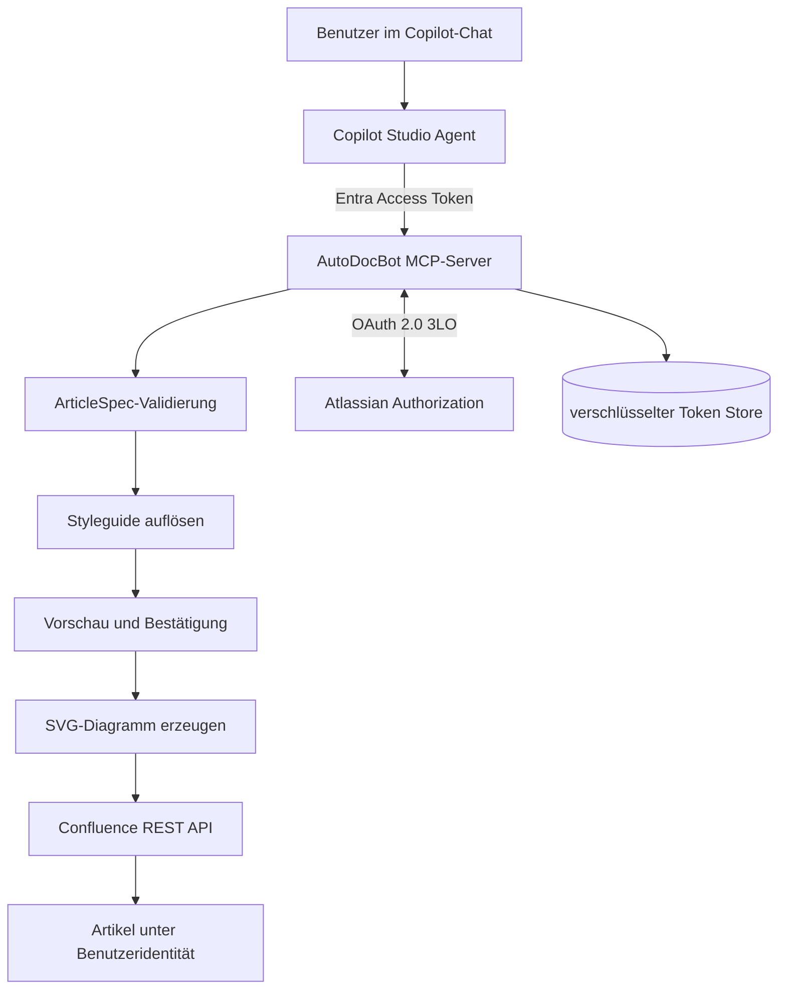
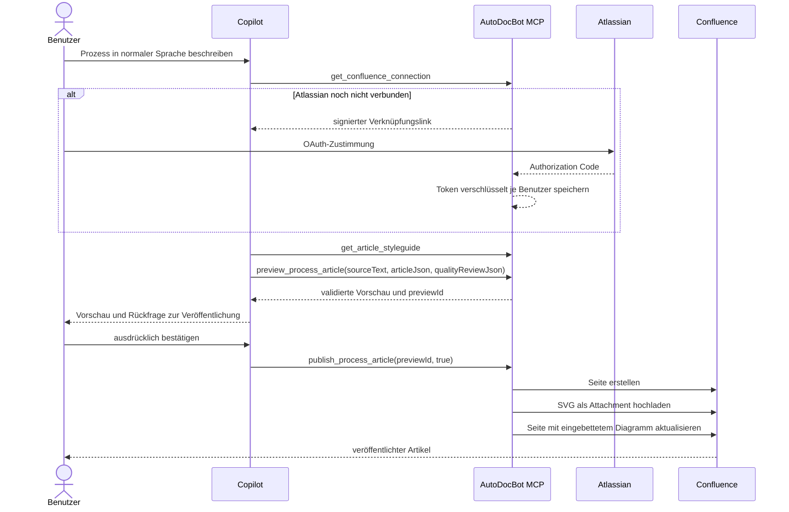

# AutoDocBot V2

AutoDocBot V2 ist ein End-to-End-verifizierter Proof of Concept für einen Copilot-Agenten, der frei formulierte Prozessbeschreibungen in konsistente Confluence-Prozessartikel umwandelt. Der Agent strukturiert den Inhalt, wendet einen verbindlichen und zugleich anpassbaren Styleguide an, erzeugt ein SVG-Prozessdiagramm und veröffentlicht den bestätigten Artikel über einen MCP-Server im Namen des angemeldeten Atlassian-Benutzers.

> Aktueller Stand: Version `0.1.4`. Lokaler Betrieb, Atlassian OAuth 2.0 (3LO), MCP Streamable HTTP, Microsoft-Entra-Authentifizierung, Copilot Studio, semantische Vorprüfung, automatische Strukturreparatur, verschlüsselte Benutzerverbindungen, Azure Container Apps sowie die bestätigte Veröffentlichung eines Artikels mit SVG-Diagramm wurden praktisch verifiziert.

## Inhaltsverzeichnis

- [Zielbild](#zielbild)
- [Funktionsumfang](#funktionsumfang)
- [Verifizierter End-to-End-Stand](#verifizierter-end-to-end-stand)
- [Architektur](#architektur)
- [Ablauf aus Benutzersicht](#ablauf-aus-benutzersicht)
- [Projektstruktur](#projektstruktur)
- [Voraussetzungen](#voraussetzungen)
- [Lokale Einrichtung](#lokale-einrichtung)
- [Atlassian-App konfigurieren](#atlassian-app-konfigurieren)
- [Konfiguration](#konfiguration)
- [MCP-Tools](#mcp-tools)
- [ArticleSpec und Styleguide](#articlespec-und-styleguide)
- [Authentifizierung und Sicherheit](#authentifizierung-und-sicherheit)
- [Copilot Studio anbinden](#copilot-studio-anbinden)
- [Container und Azure-Deployment](#container-und-azure-deployment)
- [Tests und Qualitätsprüfungen](#tests-und-qualitätsprüfungen)
- [HTTP-Endpunkte](#http-endpunkte)
- [Fehlerbehebung](#fehlerbehebung)
- [Bekannte PoC-Grenzen](#bekannte-poc-grenzen)
- [Weiterentwicklung](#weiterentwicklung)
- [Lizenz](#lizenz)

## Zielbild

Der Benutzer soll im Copilot-Chat nur den fachlichen Prozess beschreiben müssen, zum Beispiel:

> Wenn ein neuer Mitarbeiter eingestellt wird, meldet HR den Eintritt mindestens fünf Arbeitstage vorher an die IT. Die IT erstellt das Benutzerkonto und bereitet einen gereinigten Laptop vor. Fehlen Pflichtangaben, geht die Anfrage zurück an HR. Am ersten Arbeitstag übergibt die Führungskraft die Arbeitsmittel. Das Diagramm soll von oben nach unten verlaufen.

Der Copilot-Agent übernimmt daraus folgende Aufgaben:

1. Fakten, Rollen, Prozessschritte, Entscheidungen und Ausnahmen erkennen.
2. Fehlende fachliche Pflichtangaben beim Benutzer erfragen, statt sie zu erfinden.
3. Den Inhalt als validiertes `ArticleSpec` strukturieren.
4. Styleguide und erlaubte Benutzeranpassungen anwenden.
5. Eine Vorschau erzeugen und dem Benutzer zur Bestätigung zeigen.
6. Erst nach ausdrücklicher Bestätigung den Artikel veröffentlichen.
7. Ein SVG-Diagramm erzeugen, an die Confluence-Seite anhängen und als letzten Abschnitt einbetten.

## Funktionsumfang

- MCP-Server auf Basis von Streamable HTTP
- vier klar getrennte MCP-Tools für Verbindung, Styleguide, Vorschau und Veröffentlichung
- Atlassian OAuth 2.0 (3LO) mit Benutzerdelegation und Refresh Tokens
- Veröffentlichung unter der Identität des verbundenen Atlassian-Benutzers
- Ziel-Site- und Space-Prüfung vor der Veröffentlichung
- strukturierte, mit Zod validierte Artikeldaten
- deterministisches Confluence-Storage-Format statt ungeprüftem Modell-HTML
- flexibler Styleguide mit unveränderbaren Sicherheits- und Qualitätsregeln
- Diagramme in den Richtungen `top-down` und `left-right`
- Vorschau vor jeder Veröffentlichung; Vorschau-IDs sind 30 Minuten gültig und nur einmal verwendbar
- fachliche Seitentitel ohne technischen PoC- oder Zeitstempel-Zusatz
- verbindliche MCP-Serveranweisungen für Ableitung, Rückfragen, Vorschau und Veröffentlichungsbestätigung
- Microsoft-Entra-Prüfung für produktive MCP-Aufrufe
- pro Benutzer getrennte, AES-256-GCM-verschlüsselte Atlassian-Verbindungen
- Container-Image und persistenter Token Store für Azure Container Apps

Nicht Bestandteil dieses PoC sind eine Administrationsoberfläche, eine Datenbank, Versionsverwaltung für individuelle Styleguides und eine vollständig automatisierte Infrastruktur-Pipeline.

## Verifizierter End-to-End-Stand

| Baustein | Status | Nachweis im PoC |
|---|---:|---|
| Atlassian OAuth 2.0 (3LO) | verifiziert | Benutzer, Ziel-Site, Space und Refresh Token wurden erkannt |
| Veröffentlichung unter Benutzeridentität | verifiziert | Author-ID der Confluence-Seitenversion entsprach dem verbundenen Benutzer |
| Entra OAuth für MCP | verifiziert | delegierter `access_as_user`-Scope, Tenant, Audience und erlaubter Copilot-Client wurden validiert |
| Copilot-Studio-Tool-Discovery | verifiziert | alle vier MCP-Tools wurden geladen und aufgerufen |
| Benutzergebundene Atlassian-Verknüpfung | verifiziert | Copilot lieferte einen signierten Link und speicherte die Verbindung benutzerbezogen |
| ArticleSpec und Styleguide | verifiziert | natürlichsprachlicher Prozess wurde ohne Abfrage einer gewünschten Schrittzahl strukturiert |
| Vorschau und Bestätigung | verifiziert | Veröffentlichung erfolgte erst nach einer separaten Bestätigung |
| SVG-Diagramm | verifiziert | Diagramm wurde erzeugt, hochgeladen und als letzter Artikelabschnitt eingebettet |
| Azure Container Apps | verifiziert | Entra-Modus, HTTPS-Ingress, ACR-Image und persistenter Azure-File-Mount sind aktiv |

Der Stand belegt die technische Machbarkeit. Die unter [Bekannte PoC-Grenzen](#bekannte-poc-grenzen) genannten Punkte bleiben vor einem breiten Produktivbetrieb relevant.

## Architektur



Es existieren zwei voneinander getrennte OAuth-Beziehungen:

1. **Copilot → MCP-Server:** Microsoft Entra stellt ein delegiertes Access Token für die AutoDocBot-API aus. Der MCP-Server prüft Signatur, Issuer, Audience, Tenant, Benutzer, Scope und erlaubte Client-Anwendung.
2. **MCP-Server → Atlassian:** Der Benutzer verbindet sein Atlassian-Konto per OAuth 2.0 (3LO). AutoDocBot verwendet dieses Benutzertoken für Confluence-Aufrufe.

Dadurch erhält AutoDocBot weder ein globales Confluence-Servicekonto noch die Berechtigung, unabhängig vom jeweiligen Benutzer zu veröffentlichen.

## Ablauf aus Benutzersicht



## Projektstruktur

```text
.
├── src/
│   ├── article/
│   │   ├── article-spec.ts          # Zod-Schema und fachliche Validierung
│   │   ├── quality-review.ts        # semantische Vorprüfung und Qualitätsbericht
│   │   ├── quality-review-check.ts  # automatisierter Konflikttest
│   │   ├── renderer.ts              # sicheres Confluence-Storage-Rendering
│   │   ├── styleguide.ts            # Standardregeln und erlaubte Overrides
│   │   ├── sample-process.ts        # Beispielprozess für lokale Tests
│   │   └── styleguide-check.ts      # automatisierter Rendering-Check
│   ├── auth/
│   │   ├── encrypted-json-store.ts  # AES-256-GCM Token Store
│   │   ├── mcp-identity.ts          # Entra-JWT-Prüfung
│   │   └── store-check.ts           # Verschlüsselungstest
│   ├── diagram/
│   │   └── process-svg.ts           # deterministische SVG-Erzeugung
│   ├── mcp/
│   │   └── test-client.ts           # lokaler MCP-Protokolltest
│   └── server.ts                    # HTTP, OAuth, MCP und Publishing-Pipeline
├── docs/
│   ├── styleguide.md                # lesbare Styleguide-Dokumentation
│   └── copilot-agent-instructions.md # kopierfertige Studio-Anweisungen
├── azure/containerapp-volume.yaml   # Beispiel für Azure File Mount und Runtime
├── Dockerfile                       # Multi-Stage-Produktionsimage
├── .env.example                     # Konfigurationsvorlage
└── package.json
```

## Voraussetzungen

- Node.js 24 oder eine kompatible aktuelle Node.js-Version
- npm
- eine Atlassian-Cloud-Site mit Confluence
- Berechtigung, in mindestens einem Confluence-Space Seiten und Attachments anzulegen
- eine Atlassian OAuth-2.0-App
- für den produktiven Copilot-Betrieb: Microsoft-Entra-App-Registrierungen
- für Azure: Azure CLI, eine Subscription und Berechtigungen für Container Apps, ACR, Storage und Log Analytics

## Lokale Einrichtung

### 1. Repository klonen

```bash
git clone https://github.com/DWProv/AutoDocBot-V2.git
cd AutoDocBot-V2
npm ci
```

### 2. Konfiguration anlegen

```bash
cp .env.example .env
```

Mindestens diese Werte müssen in `.env` gesetzt werden:

```dotenv
ATLASSIAN_CLIENT_ID=your-atlassian-client-id
ATLASSIAN_CLIENT_SECRET=your-atlassian-client-secret
ATLASSIAN_SITE_URL=https://your-site.atlassian.net
ATLASSIAN_SPACE_ID=your-confluence-space-id
ATLASSIAN_REDIRECT_URI=http://localhost:3000/oauth/callback
AUTH_MODE=local
LOCAL_USER_ID=local:developer
PUBLIC_BASE_URL=http://localhost:3000
```

Die `.env`-Datei wird von Git ignoriert und darf nicht committed werden.

### 3. Entwicklungsserver starten

```bash
npm run dev
```

Danach `http://localhost:3000` öffnen und **Mit Atlassian verbinden** wählen. Nach erfolgreicher Zustimmung zeigt die Seite den Atlassian-Benutzer, die Cloud-ID, verfügbare Spaces und den Refresh-Token-Status an.

Für einen produktionsnahen lokalen Start:

```bash
npm run build
npm run start:prod
```

## Atlassian-App konfigurieren

In der Atlassian Developer Console wird eine OAuth-2.0-(3LO)-App benötigt.

### Callback URL

Lokal muss die Callback URL exakt mit `.env` übereinstimmen:

```text
http://localhost:3000/oauth/callback
```

Für Azure beziehungsweise eine andere öffentliche Umgebung:

```text
https://YOUR_PUBLIC_HOST/oauth/callback
```

Schon ein abweichender Slash oder eine andere Domain führt zu einem OAuth-Fehler.

### Benötigte Scopes

Folgende Scopes müssen in der Atlassian-App tatsächlich aktiviert sein:

```text
read:me
read:space:confluence
read:page:confluence
write:page:confluence
read:content-details:confluence
read:attachment:confluence
write:attachment:confluence
offline_access
```

`offline_access` ist für Refresh Tokens erforderlich. Die Attachment-Scopes werden benötigt, weil das Diagramm als SVG-Datei hochgeladen und anschließend in die Seite eingebettet wird.

### Ziel-Site und Space

`ATLASSIAN_SITE_URL` enthält nur die Site-URL ohne `/wiki`, zum Beispiel:

```text
https://example.atlassian.net
```

`ATLASSIAN_SPACE_ID` ist die numerische Space-ID, nicht der Space-Key. Beim OAuth-Callback prüft AutoDocBot, ob die erwartete Site freigegeben wurde. Beim Publishing wird zusätzlich geprüft, ob der ausgewählte Space in der für den Benutzer geladenen Space-Liste enthalten ist.

## Konfiguration

| Variable | Erforderlich | Bedeutung |
|---|---:|---|
| `ATLASSIAN_CLIENT_ID` | ja | Client-ID der Atlassian-3LO-App |
| `ATLASSIAN_CLIENT_SECRET` | ja | Secret der Atlassian-3LO-App |
| `ATLASSIAN_SITE_URL` | ja | Ziel-Site ohne abschließendes `/wiki` |
| `ATLASSIAN_SPACE_ID` | ja | standardmäßig verwendete Confluence-Space-ID |
| `ATLASSIAN_REDIRECT_URI` | ja | exakt registrierte Atlassian Callback URL |
| `PORT` | nein | HTTP-Port, Standard `3000` |
| `HOST` | nein | Bind-Adresse; lokal `127.0.0.1`, im Container `0.0.0.0` |
| `AUTH_MODE` | nein | `local` oder `entra`; Standard `local` |
| `LOCAL_USER_ID` | lokal | lokale Testidentität |
| `ENTRA_TENANT_ID` | Entra | Tenant-ID, deren Tokens akzeptiert werden |
| `ENTRA_CLIENT_ID` | Entra | Client-ID/Audience der AutoDocBot-API |
| `ENTRA_REQUIRED_SCOPE` | Entra | delegierter Scope, Standard `access_as_user` |
| `ENTRA_ALLOWED_CLIENT_IDS` | Entra | kommaseparierte Allowlist aufrufender Clients, z. B. Copilot-App |
| `PUBLIC_BASE_URL` | produktiv | öffentliche Basis-URL ohne abschließenden Slash |
| `ALLOWED_HOSTS` | nein | zusätzliche, kommaseparierte erlaubte Host-Header |
| `AUTH_LINK_SECRET` | produktiv | Signaturschlüssel für Benutzer-Kontoverknüpfungslinks |
| `TOKEN_ENCRYPTION_KEY` | Entra | Base64-kodierter Schlüssel mit exakt 32 Byte |
| `TOKEN_STORE_PATH` | nein | Pfad zum verschlüsselten Verbindungsspeicher |

Geeignete Produktionsschlüssel lassen sich beispielsweise so erzeugen:

```bash
openssl rand -base64 32  # TOKEN_ENCRYPTION_KEY
openssl rand -base64 48  # AUTH_LINK_SECRET
```

Die Werte gehören in einen Secret Store beziehungsweise in Container-App-Secrets, nicht in YAML oder Git.

## MCP-Tools

Der Streamable-HTTP-Endpunkt befindet sich unter `/mcp` und akzeptiert `POST`.

| Tool | Verändernd | Zweck |
|---|---:|---|
| `get_confluence_connection` | nein | prüft die Benutzerverbindung und liefert erlaubte Spaces oder einen signierten Atlassian-Verknüpfungslink |
| `get_article_styleguide` | nein | liefert Standardstil, erlaubte Anpassungen, feste Regeln und Agentenanweisungen |
| `preview_process_article` | nein | prüft `sourceText` und `qualityReviewJson`; nur ohne offene Probleme validiert es `articleJson` und erzeugt eine 30 Minuten gültige Vorschau-ID |
| `publish_process_article` | ja | veröffentlicht genau eine bestätigte Vorschau inklusive SVG-Diagramm |

### Vorgesehene Tool-Reihenfolge

1. `get_confluence_connection`
2. gegebenenfalls Atlassian-Verknüpfung durch den Benutzer
3. `get_article_styleguide`
4. fachliche Rückfragen stellen, bis keine relevanten Angaben fehlen
5. `preview_process_article`
6. Vorschau anzeigen und ausdrückliche Bestätigung einholen
7. `publish_process_article` mit `confirmed: true`

Der Agent darf `publish_process_article` nicht automatisch direkt nach der Vorschau aufrufen.

## ArticleSpec und Styleguide

Der Copilot erzeugt keinen fertigen HTML-Artikel. Stattdessen übergibt er drei flache String-Felder: den aktuellen konsolidierten Prozess als `sourceText`, strukturierte Artikeldaten als `articleJson` und den obligatorischen Qualitätsbericht als `qualityReviewJson`. Die Anzahl der Schritte leitet der Agent aus den beschriebenen Hauptaktionen ab; sie ist keine Benutzereingabe. Der MCP-Server prüft zuerst offene Qualitätsprobleme und parst anschließend `articleJson` als `ArticleSpec`. Die flachen Tool-Eingabefelder umgehen bekannte Schemaeinschränkungen in Copilot Studio, ohne die serverseitige Validierung aufzuweichen.

### Semantische Vorprüfung

Der Qualitätsbericht enthält exakt diese Kategorien:

```json
{
  "contradictions": [],
  "missingResponsibilities": [],
  "openQuestions": [],
  "assumptions": []
}
```

Jeder gefundene Eintrag besitzt `finding` und `question`. Zusätzlich prüft der Server den ProzessText auf explizite Unsicherheiten und typische Konflikte, etwa unbekannte Verantwortlichkeiten, unbestimmte Fristen, widersprüchliche Vorlaufzeiten oder zwei verschiedene Diagrammrichtungen.

Solange mindestens ein Problem offen ist, liefert das Vorschau-Tool:

```text
status: clarification_required
previewCreated: false
```

Es wird keine `previewId` erzeugt. Der Agent stellt die gelieferten fachlichen Fragen und ruft das Tool erst mit einem durch die Benutzerantworten bereinigten ProzessText erneut auf. Diese deterministische Vorprüfung ergänzt die Modellbewertung; sie ist keine vollständige allgemeine Widerspruchserkennung.

Ist der konsolidierte Prozess fachlich eindeutig, aber `articleJson` noch
unvollständig, antwortet das Tool nicht mit einem technischen Fehler. Stattdessen
liefert es `article_structure_retry_required`, konkrete `validationIssues` und
`requiredArticleShape`. Der Agent repariert die Struktur intern und wiederholt
den Vorschauaufruf sofort; der Benutzer wird nicht nach Schema- oder
Pflichtfeldern gefragt.

Ein verkürztes Beispiel:

```json
{
  "title": "Onboarding neuer Mitarbeitender",
  "summary": "Der Prozess beschreibt die Vorbereitung eines Neueintritts.",
  "purpose": "Konten und Arbeitsmittel stehen am ersten Arbeitstag bereit.",
  "scope": "Der Prozess gilt für neue interne Mitarbeitende.",
  "roles": [
    {
      "name": "HR",
      "responsibility": "Meldet den Eintritt vollständig und fristgerecht."
    },
    {
      "name": "IT",
      "responsibility": "Erstellt das Konto und bereitet den Laptop vor."
    }
  ],
  "prerequisites": ["Die erforderlichen Personaldaten liegen vor."],
  "steps": [
    {
      "number": 1,
      "actor": "HR",
      "action": "HR meldet den Eintritt mindestens fünf Arbeitstage vorher an die IT.",
      "result": "Die IT hat die Onboarding-Anfrage erhalten.",
      "decision": "Sind alle Pflichtangaben vorhanden?"
    }
  ],
  "exceptions": [
    {
      "condition": "Pflichtangaben fehlen.",
      "handling": "Die IT gibt die Anfrage zur Ergänzung an HR zurück."
    }
  ],
  "relatedLinks": [],
  "metadata": {
    "owner": "HR und IT"
  },
  "optionalContent": {},
  "style": {
    "tone": "concise",
    "audience": "operations",
    "diagramDirection": "top-down"
  }
}
```

Die vollständige Feldvalidierung steht in `src/article/article-spec.ts`. Unter anderem gelten folgende Grenzen:

- Titel: 5 bis 140 Zeichen
- mindestens eine Rolle und ein Prozessschritt
- maximal 30 Rollen, 50 Schritte und 30 Ausnahmen
- Schrittnummern beginnen bei 1 und müssen lückenlos sein
- URLs werden validiert
- unbekannte oder unzulässige Style-Overrides werden abgelehnt

### Verbindliche Styleguide-Regeln

- Sprache `de-DE`
- keine erfundenen Fakten
- aktive Sprache
- explizite Rollen
- eine Hauptaktion pro Schritt
- kein Benutzer-HTML oder direktes Confluence-Markup
- Diagramm immer als letzter fachlicher Abschnitt

### Erlaubte Benutzeranpassungen

- Ton: `formal`, `neutral`, `concise`, `friendly`
- Zielgruppe: `general`, `expert`, `management`, `operations`
- Detailgrad: `compact`, `standard`, `detailed`
- Anrede: `neutral`, `du`, `sie`
- Diagrammrichtung: `top-down`, `left-right`
- optionale Abschnitte: Definitionen, Systeme, Risiken/Kontrollen, Kennzahlen, Änderungshistorie
- Terminologie-Ersetzungen und alternative Überschriften

Weitere Beispiele enthält [`docs/styleguide.md`](docs/styleguide.md).

## Authentifizierung und Sicherheit

<details>
<summary><strong>ELI5: Wie funktioniert der Autorisierungsprozess?</strong></summary>

AutoDocBot passiert zwei voneinander getrennte Türsteher:

1. **Microsoft Entra prüft:** „Wer benutzt gerade den Copilot-Agenten?“
2. **Atlassian prüft:** „Darf AutoDocBot für diese Person in Confluence
   arbeiten?“

Stell dir AutoDocBot als Assistenten in einem Bürogebäude vor. Dein
Microsoft-Ausweis bringt dich in das Büro von AutoDocBot. Dein
Atlassian-Ausweis erlaubt AutoDocBot anschließend, in deinem Namen in
Confluence zu arbeiten. AutoDocBot erhält dabei keine Passwörter, sondern
technische Zutrittskarten – die OAuth-Tokens.

### 1. Copilot weist den Benutzer gegenüber AutoDocBot aus

Der Benutzer ist im Copilot bereits mit seinem Microsoft-Konto angemeldet.
Copilot erhält von Microsoft Entra ein Access Token für die AutoDocBot-API und
sendet es bei jedem MCP-Aufruf mit. Der MCP-Server prüft unter anderem:

- Stammt das Token wirklich vom konfigurierten Entra-Tenant?
- Ist es für die AutoDocBot-API bestimmt und noch gültig?
- Besitzt es den erforderlichen delegierten Scope?
- Welcher Benutzer und welche erlaubte Client-Anwendung stecken dahinter?

Damit kennt AutoDocBot die stabile Microsoft-Benutzeridentität, ohne ein
Microsoft-Passwort zu erhalten.

### 2. AutoDocBot prüft die Confluence-Verbindung

Der Agent ruft `get_confluence_connection` auf. Der MCP-Server sucht im
verschlüsselten Token Store nach einer Atlassian-Verbindung für genau diese
Microsoft-Benutzeridentität. Existiert noch keine Verbindung, erzeugt er einen
kurzzeitig gültigen, signierten Autorisierungslink. Dieser Link ist an den
aktuellen Benutzer gebunden.

### 3. Der Benutzer stimmt bei Atlassian zu

Der Link führt direkt zu Atlassian. Dort meldet sich der Benutzer an und sieht,
welche Berechtigungen AutoDocBot anfordert, beispielsweise Confluence-Spaces und
Seiten lesen sowie Seiten und Diagramm-Anhänge erstellen. Das
Atlassian-Passwort bleibt vollständig bei Atlassian und ist für AutoDocBot nie
sichtbar.

### 4. Atlassian gibt AutoDocBot einen einmaligen Code

Nach der Zustimmung leitet Atlassian den Browser zum registrierten Callback
zurück:

```text
/oauth/callback?code=...
```

Dieser Code ist ein einmalig einlösbarer Abholschein. Der MCP-Server tauscht ihn
bei Atlassian gegen ein Access Token und – durch `offline_access` – ein Refresh
Token. Zusätzlich ermittelt AutoDocBot die autorisierte Site, Cloud-ID,
Benutzeridentität und verfügbaren Confluence-Spaces.

### 5. Beide Identitäten werden sicher miteinander verknüpft

AutoDocBot speichert sinngemäß folgende Zuordnung:

```text
Microsoft-Benutzer
→ dessen Atlassian-Verbindung
→ autorisierte Site und Spaces
→ verschlüsselte OAuth-Tokens
```

Jeder Microsoft-Benutzer besitzt dadurch eine eigene Atlassian-Verbindung. Die
Tokens werden nicht an Copilot zurückgegeben und nicht in Git gespeichert. Sie
liegen verschlüsselt im persistenten `/data`-Token-Store.

### 6. Veröffentlichung im Namen des Benutzers

Nach der ausdrücklichen Bestätigung einer Vorschau bestimmt der MCP-Server über
das Entra-Token erneut den aktuellen Benutzer. Er lädt ausschließlich dessen
Atlassian-Verbindung und ruft damit die Confluence API auf. Deshalb erscheint
der verbundene Atlassian-Benutzer als Autor und nicht ein allgemeiner
Bot-Account.

Läuft das kurzlebige Access Token ab, verwendet AutoDocBot das verschlüsselte
Refresh Token, um ein neues anzufordern. Eine erneute Anmeldung ist erst nötig,
wenn die Verbindung widerrufen oder ungültig wurde beziehungsweise die
Berechtigungen nicht mehr ausreichen.

### Drei getrennte Sicherheitsentscheidungen

```text
Microsoft Entra
„Wer spricht mit AutoDocBot?“

Atlassian OAuth
„Was darf AutoDocBot für diese Person in Confluence tun?“

Veröffentlichungsbestätigung
„Soll genau diese Vorschau jetzt wirklich veröffentlicht werden?“
```

Der Entra Admin Consent und die Atlassian-Zustimmung sind nicht dasselbe: Der
Admin Consent erlaubt den Zugriff auf die AutoDocBot-API. Die individuelle
Atlassian-Zustimmung erlaubt AutoDocBot anschließend die Confluence-Arbeit im
Namen des jeweiligen Benutzers.

</details>

### Lokaler Modus

`AUTH_MODE=local` ist ausschließlich für Entwicklung gedacht. Ohne Header verwendet der Server `LOCAL_USER_ID`; über `x-autodoc-user-id` kann der Testclient eine andere lokale Identität simulieren. Dieser Modus darf nicht offen im Internet betrieben werden.

### Entra-Modus

`AUTH_MODE=entra` erwartet am MCP-Endpunkt ein Bearer Access Token und prüft:

- RS256-Signatur über die Microsoft-JWKs
- Entra-v2-Issuer des konfigurierten Tenants
- Audience der AutoDocBot-API
- Tenant Claim `tid`
- Benutzerobjekt `oid`
- delegierten Scope in `scp`
- Ausschluss reiner App-Tokens
- aufrufende Client-ID über `azp` beziehungsweise `appid`
- Client-ID gegen `ENTRA_ALLOWED_CLIENT_IDS`

Der Benutzer-Schlüssel im Token Store wird aus `tenantId:objectId` gebildet. Dadurch sind Atlassian-Verbindungen verschiedener Benutzer logisch getrennt.

### Atlassian-Kontoverknüpfung

Im Entra-Modus kann `/oauth/start` nicht frei aufgerufen werden. `get_confluence_connection` erzeugt einen zeitlich begrenzten, signierten Link, der die aktuelle MCP-Benutzeridentität bindet. OAuth-State und Link sind jeweils nur begrenzt gültig.

### Token Store

- jede gespeicherte Verbindung wird separat mit AES-256-GCM verschlüsselt
- zufälliger IV und Authentifizierungs-Tag je Datensatz
- atomisches Schreiben über eine temporäre Datei
- Dateirechte `0600`, Verzeichnisrechte `0700`
- ablaufende Atlassian Access Tokens werden über den Refresh Token erneuert
- im lokalen Modus entsteht der ignorierte Schlüssel `.local/token-encryption.key`
- im Entra-Modus ist ein extern bereitgestellter `TOKEN_ENCRYPTION_KEY` zwingend

Wichtig: Wer sowohl die verschlüsselte Datei als auch den Verschlüsselungsschlüssel besitzt, kann die Tokens entschlüsseln. Beide Komponenten müssen getrennt geschützt und gesichert werden.

## Copilot Studio anbinden

Für den produktiven Zugriff werden typischerweise zwei Entra-App-Registrierungen verwendet.

### 1. API-App für AutoDocBot

1. App-Registrierung für die MCP-API anlegen.
2. Unter **Expose an API** eine Application ID URI konfigurieren, üblicherweise `api://<API-CLIENT-ID>`.
3. Delegierten Scope `access_as_user` anlegen.
4. Im Manifest der API-App `api.requestedAccessTokenVersion` auf `2` setzen. Andernfalls kann Entra bei einer Single-Tenant-App ein v1-Token mit einem abweichenden Issuer ausstellen.
5. Tenant-ID und API-Client-ID als `ENTRA_TENANT_ID` und `ENTRA_CLIENT_ID` konfigurieren.

Alternativ lässt sich die Token-Version mit der Azure CLI setzen:

```bash
az ad app update \
  --id <API-CLIENT-ID> \
  --requested-access-token-version 2
```

Der vollständige Scope lautet dann:

```text
api://<API-CLIENT-ID>/access_as_user
```

### 2. Client-App für Copilot

1. separate App-Registrierung für Copilot anlegen
2. Client Secret erstellen und sicher speichern
3. die delegierte API-Berechtigung `access_as_user` der AutoDocBot-API hinzufügen
4. falls durch die Organisation gefordert, Admin Consent erteilen
5. die Client-ID in `ENTRA_ALLOWED_CLIENT_IDS` aufnehmen
6. die von Copilot Studio angezeigte Redirect URL als Web-Redirect-URI registrieren

### 3. OAuth-Werte in Copilot Studio

```text
Authorization URL:
https://login.microsoftonline.com/<TENANT-ID>/oauth2/v2.0/authorize

Token URL:
https://login.microsoftonline.com/<TENANT-ID>/oauth2/v2.0/token

Scope:
openid profile offline_access api://<API-CLIENT-ID>/access_as_user

MCP endpoint:
https://<PUBLIC-HOST>/mcp
```

Je nach aktueller Copilot-Studio-Oberfläche heißen die Felder leicht anders. Entscheidend sind der delegierte Scope, der richtige Client und die korrekte Redirect URL.

### Empfohlene Agentenanweisung

Die vollständige kopierfertige Studio-Anweisung steht in
[`docs/copilot-agent-instructions.md`](docs/copilot-agent-instructions.md). Der
MCP-Server liefert die zentralen Regeln zusätzlich als MCP-Serveranweisungen aus.

## Container und Azure-Deployment

### Docker lokal

```bash
docker build -t autodocbot-v2:0.1.4 .
docker run --rm -p 3000:3000 --env-file .env autodocbot-v2:0.1.4
```

Das Multi-Stage-Dockerfile kompiliert TypeScript im Build-Image und übernimmt nur Produktionsabhängigkeiten sowie `dist/` in das Runtime-Image. Der Prozess läuft als unprivilegierter Benutzer `node`.

### Benötigte Azure-Ressourcen

- Azure Container Registry für das Image
- Azure Container Apps Environment
- Azure Container App mit externer HTTPS-Ingress-Regel auf Port 3000
- Storage Account und Azure File Share für `connections.json`
- Log Analytics Workspace
- verwaltete Identität der Container App mit Pull-Zugriff auf die Registry

Ein beispielhafter Aufbau:

```bash
RG=your-resource-group
LOCATION=westeurope
ACR=youruniqueregistry
STORAGE=youruniquestorage
ENVIRONMENT=cae-autodocbot-v2
APP=autodocbot-v2

az acr create -g "$RG" -n "$ACR" --sku Basic --admin-enabled false
az storage account create -g "$RG" -n "$STORAGE" -l "$LOCATION" --sku Standard_LRS --min-tls-version TLS1_2
az storage share-rm create -g "$RG" --storage-account "$STORAGE" --name autodocbot-tokenstore --quota 1
az containerapp env create -g "$RG" -n "$ENVIRONMENT" -l "$LOCATION"
az acr build -r "$ACR" -t autodocbot-v2:0.1.4 .
```

Danach wird der File Share im Container-Apps-Environment registriert:

```bash
STORAGE_KEY=$(az storage account keys list -g "$RG" -n "$STORAGE" --query '[0].value' -o tsv)

az containerapp env storage set \
  -g "$RG" \
  -n "$ENVIRONMENT" \
  --storage-name tokenstore \
  --access-mode ReadWrite \
  --azure-file-account-name "$STORAGE" \
  --azure-file-account-key "$STORAGE_KEY" \
  --azure-file-share-name autodocbot-tokenstore
```

Die Container App benötigt anschließend:

- Image `<ACR>.azurecr.io/autodocbot-v2:0.1.4`
- externe Ingress-Regel, Zielport `3000`
- `AUTH_MODE=entra`
- alle Entra- und Atlassian-Werte aus der Konfigurationstabelle
- Secrets für `ATLASSIAN_CLIENT_SECRET`, `TOKEN_ENCRYPTION_KEY` und `AUTH_LINK_SECRET`
- `TOKEN_STORE_PATH=/data/connections.json`
- Azure-File-Mount `tokenstore` auf `/data`
- für diesen PoC genau eine Replica, weil Vorschauen und OAuth-State im Arbeitsspeicher liegen

[`azure/containerapp-volume.yaml`](azure/containerapp-volume.yaml) zeigt die erwarteten Environment- und Volume-Strukturen. Vor der Verwendung müssen alle `YOUR_...`-Platzhalter und der Registry-Name ersetzt werden. Geheimniswerte werden als Container-App-Secrets angelegt und nur über `secretRef` referenziert.

Nach dem Deployment müssen `PUBLIC_BASE_URL`, `ALLOWED_HOSTS` und `ATLASSIAN_REDIRECT_URI` den tatsächlichen Container-App-Host enthalten. Anschließend ist dieselbe öffentliche Callback URL auch in der Atlassian Developer Console einzutragen.

### Deployment prüfen

```bash
curl https://<PUBLIC-HOST>/healthz
curl https://<PUBLIC-HOST>/.well-known/oauth-protected-resource
```

Ein nicht authentifizierter `POST` auf `/mcp` muss im Entra-Modus mit `401` und einem `WWW-Authenticate`-Header antworten. Ein öffentlich erreichbares MCP ohne Authentifizierung ist kein erfolgreicher Produktionscheck.

## Tests und Qualitätsprüfungen

```bash
npm run typecheck
npm run build
npm run check:styleguide
npm run check:quality-review
npm run check:token-store
```

Der MCP-Test benötigt einen laufenden lokalen Server auf Port 3000:

```bash
npm run dev
# in einem zweiten Terminal
npm run test:mcp
```

`test:mcp` prüft Tool Discovery, Verbindungsstatus und Vorschauerzeugung. Der Test veröffentlicht keine Confluence-Seite.

| Script | Prüfung |
|---|---|
| `npm run typecheck` | TypeScript ohne Ausgabe kompilierbar |
| `npm run build` | Produktionsartefakte in `dist/` erzeugen |
| `npm run check:styleguide` | ArticleSpec, Overrides, Terminologie, sicheres Rendering und Diagrammposition |
| `npm run check:quality-review` | explizite Widersprüche, unbestimmte Fristen und fehlende Verantwortlichkeiten |
| `npm run check:token-store` | Verschlüsselung, erneutes Laden und Löschen des Stores |
| `npm run test:mcp` | MCP-Verbindung, erwartete Tools und nicht publizierende Vorschau |

## HTTP-Endpunkte

| Methode | Pfad | Zweck |
|---|---|---|
| `GET` | `/healthz` | Healthcheck und aktiver Auth-Modus |
| `GET` | `/.well-known/oauth-protected-resource` | OAuth Protected Resource Metadata im Entra-Modus |
| `POST` | `/mcp` | MCP Streamable HTTP |
| `GET` | `/` | lokale PoC-Startseite |
| `GET` | `/oauth/start` | Atlassian-3LO starten |
| `GET` | `/oauth/callback` | Atlassian OAuth Callback |
| `POST` | `/create-test-page` | lokale manuelle Testseite |
| `POST` | `/create-diagram-page` | lokale Diagramm-Testseite |
| `GET` | `/article-preview` | lokale Beispielvorschau |
| `POST` | `/publish-article` | lokale Veröffentlichung der Beispielvorschau |

Die manuellen HTML-Testendpunkte sind PoC-Hilfen. Für die Copilot-Integration ist ausschließlich `/mcp` vorgesehen.

## Fehlerbehebung

### Atlassian meldet nicht aktivierte Scopes

Die Scopes müssen nicht nur im Authorization Request stehen, sondern in der Developer Console bei der richtigen API aktiviert sein. Besonders häufig fehlen `read:page:confluence`, `write:page:confluence` oder `read:space:confluence`. Nach Scope-Änderungen ist eine erneute Zustimmung erforderlich.

### `Could not create content with type page`

AutoDocBot verwendet die Confluence REST API v2 und sendet beim Erstellen `spaceId`, `status`, `title` und `body`. Bei eigenen Erweiterungen darf nicht das alte v1-Format mit einem ungeeigneten Content-Type-Payload vermischt werden.

### OAuth Callback oder State ungültig

- Callback URL in Atlassian und `ATLASSIAN_REDIRECT_URI` exakt vergleichen
- OAuth innerhalb von zehn Minuten abschließen
- Server während des OAuth-Flows nicht neu starten
- im Entra-Modus den Link aus `get_confluence_connection` verwenden

### MCP antwortet mit `401 invalid_token`

Prüfen:

- Access Token statt ID Token gesendet
- Audience entspricht `ENTRA_CLIENT_ID`
- `scp` enthält `ENTRA_REQUIRED_SCOPE`
- `tid` entspricht `ENTRA_TENANT_ID`
- `azp`/`appid` steht in `ENTRA_ALLOWED_CLIENT_IDS`
- Token stammt vom v2.0-Issuer des richtigen Tenants
- bei `unexpected "iss" claim value`: `api.requestedAccessTokenVersion=2` an der API-App setzen und die Copilot-OAuth-Verbindung neu erstellen

### MCP antwortet mit `403 Invalid Host header`

`PUBLIC_BASE_URL` muss dem aufgerufenen Host entsprechen. Zusätzliche Reverse-Proxy-Hosts können kommasepariert über `ALLOWED_HOSTS` freigegeben werden.

### `TOKEN_ENCRYPTION_KEY muss 32 Byte ... enthalten`

Der dekodierte Wert muss exakt 32 Byte lang sein. Einen passenden Wert erzeugt `openssl rand -base64 32`.

### Verbindung verschwindet nach Container-Neustart

Prüfen, ob `TOKEN_STORE_PATH=/data/connections.json` gesetzt und ein beschreibbarer Azure File Share auf `/data` gemountet ist. Außerdem muss nach einem Neustart derselbe `TOKEN_ENCRYPTION_KEY` verwendet werden.

### Seite wird erstellt, Diagramm fehlt

Die Veröffentlichung erfolgt in drei API-Schritten: Seite erstellen, SVG hochladen, Seite aktualisieren. Prüfe Attachment-Scopes, Schreibrechte, Container-Logs und eine mögliche Teilstörung zwischen diesen Schritten.

### Autor ist nicht der erwartete Benutzer

AutoDocBot verwendet das Atlassian-3LO-Token der zugehörigen MCP-Benutzeridentität. Prüfe, welches Atlassian-Konto den Verknüpfungsdialog bestätigt hat. Die Publishing-Antwort enthält zusätzlich `attributionConfirmed`, sofern Confluence die Author-ID der neuen Version liefert.

## Bekannte PoC-Grenzen

- Vorschauen und OAuth-State liegen im Arbeitsspeicher. Ein Neustart macht sie ungültig.
- Mehrere Replicas benötigen einen gemeinsamen Store für Vorschauen und OAuth-State; deshalb läuft der aktuelle PoC mit einer Replica.
- Die Publishing-Pipeline ist nicht transaktional. Ein Fehler beim Attachment kann eine bereits angelegte Seite ohne fertiges Diagramm hinterlassen.
- Neue Seiten verwenden den fachlichen ArticleSpec-Titel ohne PoC-Zusatz. Ein eigener Aktualisierungs- oder Konfliktablauf für bereits vorhandene gleichnamige Seiten fehlt noch.
- Die Liste erlaubter Spaces wird beim Atlassian-Login geladen und ist nicht unbegrenzt paginiert.
- Es gibt noch keine Benutzeroberfläche zur Verwaltung oder zum Widerruf gespeicherter Verbindungen.
- Styleguide und ArticleSpec sind im Code versioniert; eine mandantenfähige Konfigurationsverwaltung ist noch nicht umgesetzt.
- Monitoring, Alerting, Rate-Limit-Behandlung, Backups und automatisierte Deployment-Pipelines müssen vor einem Produktivbetrieb ergänzt werden.

## Weiterentwicklung

Sinnvolle nächste Schritte:

1. Vorschau- und OAuth-State in Redis oder einer Datenbank persistieren.
2. Idempotente Publishing-Jobs mit Fehlerstatus, Wiederaufnahme und Behandlung gleichnamiger Seiten einführen.
3. Styleguides pro Organisation oder Space versionieren.
4. Audit-Events ohne Token- oder Inhaltslecks protokollieren.
5. Monitoring, Alerting und Backup-Strategien ergänzen.
6. Automatisierte Unit-, Integrations- und Copilot-End-to-End-Tests ausbauen.
7. Infrastructure as Code und CI/CD aufbauen.

## Lizenz

Für dieses Repository ist derzeit keine Lizenzdatei hinterlegt. Ohne Lizenz bleiben die gesetzlichen Standardrechte beim Urheber. Vor einer externen Wiederverwendung sollte eine passende Open-Source- oder proprietäre Lizenz festgelegt werden.
